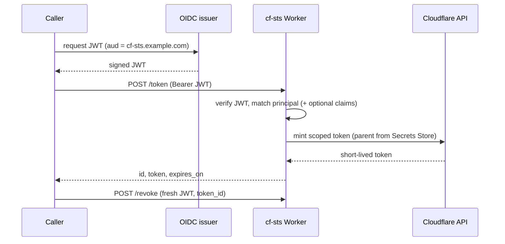

# cloudflare-sts

OIDC → short-lived Cloudflare API token broker (Cloudflare Worker). Callers prove identity with an OIDC JWT; the parent Cloudflare credential never leaves the Worker.



## Policy

```text
policy/<provider>/<account>/<resource>[/<principal>]/policy.yaml
```

| Segment | Meaning |
|---------|---------|
| **provider** | `github` · `gcp` · `spiffe` · `aws` (`policy/issuers.yaml`) |
| **account** | Org / GCP project / trust domain / AWS account |
| **resource** | Repo, SA, workload, cluster, … |
| **principal** *(optional)* | Filesystem slug for that caller (Environment, ref, …) |

Rules match JWT **principal** (GitHub `sub`, GCP SA `email`, SPIFFE/AWS `sub`) plus optional `claims`. **One identity → one path/rule** (no cross-file merge).

Build: `npm run build:policy` → gitignored `policy.bundle.json` (generated in CI/CD and locally via `pretest`). Details: **[docs/](./docs/)** · grants/profiles: **[docs/grants.md](./docs/grants.md)**.

Example GitHub rules under `policy/github/example/`: `cloudflare-sts/ci-usecase`, `cloudflare-sts/environment-production`, `example-app`.

## Deploy

```bash
npm install
npm run build:policy && npm run verify:policy
npx wrangler d1 migrations apply DB --remote   # before first deploy
npm test && npx wrangler deploy
```

Parent token: create in the Cloudflare dashboard only (API/Terraform cannot create tokens that manage other tokens). It must hold the union of every rule’s permissions.

## CI/CD

Workflows under [`.github/workflows/`](./.github/workflows/) are **reference for forks** (Actions are disabled on this upstream). See **[docs/ci.md](./docs/ci.md)**. Locally: `npm test` && `npm run verify:policy`.

## Use (GitHub Actions)

```yaml
permissions: { id-token: write, contents: read }
steps:
  - uses: WileyLabs/cloudflare-sts/action@v0.0.1
    with: { ttl-seconds: 300 }
  # $CLOUDFLARE_API_TOKEN — revoked when the job ends
```

Each OIDC JWT is single-use; request a fresh one for `/token` and `/revoke`. Curl helper: [docs/examples/curl-exchange.sh](./docs/examples/curl-exchange.sh).

## API (summary)

| | |
|-|-|
| `POST /token` | Bearer JWT; optional `{ ttl_seconds, permissions }` → `{ id, token, expires_on, rule }` |
| `POST /revoke` | Fresh JWT + `{ token_id }` → `{ revoked: true, id }` (same issuer+subject) |
| Errors | `{ "error": "<code>" }` — [docs/api.md](./docs/api.md) |

Dashboard: `GET /` (+ `/api/*`). Optional Cloudflare Access via `ACCESS_TEAM_DOMAIN` / `ACCESS_AUD`.

## Issuers

| type | docs |
|------|------|
| github | [docs/issuers/github.md](./docs/issuers/github.md) |
| gcp | [docs/issuers/gcp.md](./docs/issuers/gcp.md) |
| spiffe | [docs/issuers/spiffe.md](./docs/issuers/spiffe.md) |
| aws | [docs/issuers/aws.md](./docs/issuers/aws.md) (IAM outbound identity federation; set `iss`/`jwks` from the account issuer) |

Replay uses `jti`, else `sha256(header.payload)`. Modules: `src/issuers/`.

## Ops notes

- Rate limit: `RATE_LIMIT` (per IP + per `iss:sub`); missing binding → 500.
- Audit: D1 `mints` / `denials` / `used_jti` (replay is hard-required; audit writes are best-effort).
- Zone WAF allow-lists caller IPs; rule `client_ips` can pin the minted token.
- Token names: `sts/<rule>/<sha(iss:sub)[:12]>/<ts>` (GitHub still accepts legacy `sha(sub)` on revoke). Never log the parent or minted secret.

## License

This project is licensed under the [MIT License](./LICENSE). See [NOTICE](./NOTICE) for copyright.

## Contributing

See [CONTRIBUTING.md](./CONTRIBUTING.md) and the [Code of Conduct](./CODE_OF_CONDUCT.md).

