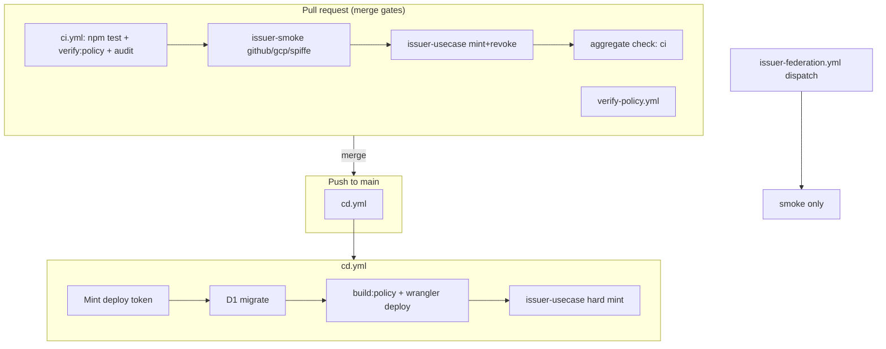

# CI / CD

Workflows live under [`.github/workflows/`](../.github/workflows/). **GitHub Actions are disabled on this upstream repo** (forks enable them and point jobs at their own Worker).

Audience / URL defaults: `cf-sts.example.com`. Replace with your hostname before relying on issuer-usecase / CD.

| Runner | Used for |
|--------|----------|
| `ubuntu-latest` | unit tests, verify-policy, CD, github/gcp/spiffe/aws issuer jobs |

SPIFFE jobs install the `spire-agent` CLI if missing (`scripts/ci/install-spire-agent.sh`). Provide a workload API socket on the runner if you enable those jobs.

## Workflows

| Workflow | Trigger | Role |
|----------|---------|------|
| [`ci.yml`](../.github/workflows/ci.yml) | **PR** · manual | Unit tests → issuer-smoke → **issuer-usecase** → aggregate check `ci` |
| [`verify-policy.yml`](../.github/workflows/verify-policy.yml) | **PR** · manual | Schema + semantics + generate `policy.bundle.json` (not committed) |
| [`reusable-issuer-smoke.yml`](../.github/workflows/reusable-issuer-smoke.yml) | `workflow_call` | Dispatches `.github/actions/issuer-smoke/<issuer>` |
| [`reusable-issuer-usecase.yml`](../.github/workflows/reusable-issuer-usecase.yml) | `workflow_call` | Dispatches `.github/actions/issuer-usecase/<issuer>` (mint → DNS Read → revoke) |
| [`issuer-federation.yml`](../.github/workflows/issuer-federation.yml) | Manual / `workflow_call` | Smoke matrix without unit tests |
| [`cd.yml`](../.github/workflows/cd.yml) | **push `main`** · manual | Deploy + hard issuer-usecase (PR already ran full CI) |

**Why no CI on `main` push:** the PR already ran test/smoke/usecase/verify. CD still re-runs hard usecase **after** deploy against the live Worker.

CD uses GitHub Environment `production` and rule `cloudflare-sts-deploy` (`policy/github/example/cloudflare-sts/environment-production/`). No long-lived Cloudflare credential in GitHub. **Bootstrap:** first deploy of that rule must be local (`npx wrangler deploy`).



## Issuer smoke vs usecase

| | Smoke (`.github/actions/issuer-smoke/<issuer>`) | Usecase (`.github/actions/issuer-usecase/<issuer>`) |
|-|-------|---------|
| When | After unit tests (PR) | After smoke (PR); after deploy (CD) |
| Pass | JWT verifies (`200` or `403 no_matching_rule`) | **Mint** via [`action/`](../action/) → **list DNS** for your zone → post-revoke |
| github | `getIDToken` | Composite action (GitHub OIDC) |
| gcp | WIF one-shot ID token → exchange | WIF `auth_token` → `jwt-command` → IAM `generateIdToken` → DNS Read |
| spiffe | runner + install CLI + fetch SVID (no mint — avoids jti burn) | mint + DNS Read after mint |
| aws | not in smoke matrix | AWS IAM user (static key secrets) → `sts:GetWebIdentityToken` → mint → DNS Read. Soft-skip (`allow_no_rule`) until infra applied — see [issuers/aws.md](./issuers/aws.md) |

Policies: `ci-usecase` / `cf-sts-ci` (dns-read).

Pass criteria for a real exchange: HTTP **200** (mint) or **403 `no_matching_rule`** (JWT verified, no rule yet). Other **401** fails. Smoke **never** logs minted `.token` values.

## Fork checklist

1. Enable Actions on the fork.
2. Set `cf_sts_url` / `audience` in workflow calls to your Worker (or soft-skip usecase with `allow_no_rule` until it exists).
3. Configure secrets/vars referenced by CD (`CLOUDFLARE_ACCOUNT_ID`, optional AWS keys).
4. Align `policy/github/…` principals with your org/repo and Environment names.

## Local checks (always work without Actions)

```bash
npm ci
npm test
npm run verify:policy
```
