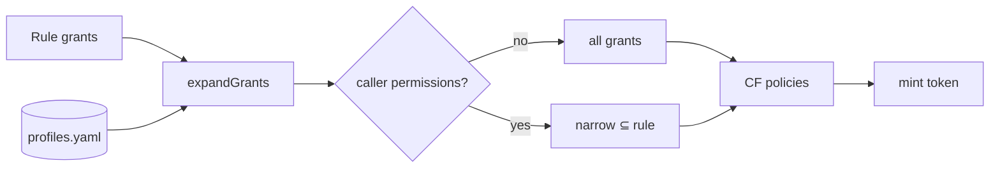

# Grants, profiles, and permissions

A matched rule tells cf-sts **what Cloudflare API token to mint**. That shape is declared as **grants** (preferred) or raw Cloudflare `policies`.



## Grant shape

Each grant is **exactly one** of:

| Form | Meaning |
|------|---------|
| `{ permissions: ["DNS Read", …] }` | Inline Cloudflare permission-group **names** |
| `{ profile: dns-read }` | Reuse a named set from `policy/profiles.yaml` |

Optional `zones`:

| `zones` | Scope of the minted policy |
|---------|----------------------------|
| omitted | Whole **account** |
| `[example.com, …]` | Those **zones** (names resolved to IDs at mint) |
| `["*"]` | Every zone (nested under the account; cannot mix `*` with names) |

```yaml
# policy/profiles.yaml
dns-read:
  permissions: [DNS Read]

worker-deploy-account:
  permissions:
    - Workers Scripts Write
    - D1 Write
    - Account Settings Read
    - Secrets Store Write

# in a rule
grants:
  - profile: worker-deploy-account          # account-scoped
  - profile: worker-deploy-zone             # zone-scoped
    zones: [example.com]
  - permissions: [Cloudflare Tunnel Write]  # one-off, no profile
```

Shipped profiles: `dns-read`, `worker-deploy-account` (includes Connectivity Directory Admin for Workers VPC bindings), `worker-deploy-zone`. Add more in `policy/profiles.yaml` as needed.

## Expansion and mint

1. **`expandGrants(rule, profiles)`** — each grant becomes `{ permissions: [...unique names], zones? }`.
2. **Name → ID** — Worker looks up Cloudflare permission groups (account vs zone scope) and zone IDs; unknown name/zone → `500 unknown_permission_group` / `unknown_zone`.
3. **One grant → one CF policy** — `effect: allow` + resources + `permission_groups: [{ id }]`.
4. Parent token (Secrets Store) must already hold the **union** of every rule’s permissions; otherwise Cloudflare rejects the mint.

Dashboard / audit store the **readable** grants (names + zones), not only IDs.

## Caller narrowing

`POST /token` body may include `"permissions": ["DNS Read", …]`:

- Allowed only when the rule uses **grants** (not raw-only `policies`) → else `400 narrowing_unsupported`.
- Every requested name must appear in the rule’s expanded grants → else `403 permission_not_allowed`.
- Minted token gets the **intersection** (never more than the rule).

## Raw `policies` (escape hatch)

Rules may also set Cloudflare-shaped `policies` (`permission_groups`, `resources`, `effect`). Use for rare deny/resource shapes. Prefer grants for new rules. Narrowing does not apply to raw policies.

## Validation

Build/verify reject: empty grants, both `profile` and `permissions`, unknown profile, empty permission lists, invalid zone names, `*` mixed with zone names. Schemas: `policy/schema/profiles.schema.json`, resource-policy schema; runtime: `src/policy.js`.
